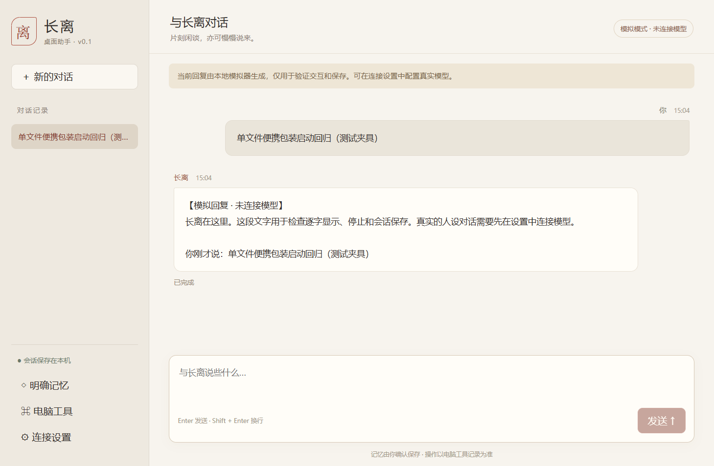

# 长离桌面助手

以《鸣潮》长离为角色的 Windows 文字桌面助手，支持本地会话、明确记忆和少量电脑工具。采用 Electron + Vue 3 + TypeScript + SQLite。

这是非官方同人项目，与游戏官方无关联。当前使用“离”字占位形象，不附带官方立绘、音乐或角色音色。原创程序代码采用 [MIT 许可证](LICENSE)，第三方与角色说明见 [THIRD_PARTY_NOTICES.md](THIRD_PARTY_NOTICES.md)。

[版本下载](https://github.com/ichangli/changli-desktop-agent/releases) · [问题反馈](https://github.com/ichangli/changli-desktop-agent/issues) · [开发计划](docs/PLAN.md) · [验证记录](docs/VERIFICATION.md)

## 当前状态

当前源码版本为 **v0.2.0-beta.2**（导航整合），新增会话管理、备份恢复、系统托盘和应用内检查更新。24 项核心测试、四组 Electron 桌面回归及云端 Windows CI/发布检查通过，Windows x64 ZIP 与单文件便携 EXE 已提供下载。具体证据与限制见验证记录。

已有用户反馈真实 API、聊天、记忆与工具检查通过；自动化模型测试使用本机 SSE 夹具，应用启动测试使用启动桩。两类证据分别记录在 [验证记录](docs/VERIFICATION.md)，不将测试夹具称为真实供应商验证。

## 导航

侧栏保留“记忆 / 工具 / 设置”三个入口。设置页分为“模型连接 / 窗口与托盘 / 数据与备份 / 关于与更新”四个页签；切换页签保留当前表单草稿，不会自动保存、检查连接或检查更新。支持方向键、Home、End 切换页签。单会话改名、删除与导出仍位于聊天页。

## v0.2 新功能

2026-10-30 新增会话管理与备份、桌面常驻和检查更新；v0.1.0 下载包不包含这些功能。

- 聊天页顶部管理当前会话；侧栏搜索历史，最多返回 100 段匹配会话。删除会话同时删除其工具记录，长期记忆保留；删除最后一段后建立空会话。
- “设置 → 数据与备份”导出全部聊天与明确记忆。JSON 为明文，排除 API 密钥、连接设置、应用配置/授权与工具记录；单会话可导出为 Markdown。
- 恢复先选文件、查看数量，再确认导入新副本，不覆盖原有记录。相同内容/类别的记忆跳过；同一份备份成功恢复后不重复导入。恢复后的未完成回复为中断，不执行历史工具。
- 记忆总量限 100 条，备份限 50 MiB、5000 段会话、100000 条消息，超过限制或格式损坏整份拒绝。恢复失败通过事务回滚，不留下部分记录。正式/开发数据仍独立。
- “设置 → 窗口与托盘”可选择关闭窗口直接退出（默认），或关闭到系统托盘继续运行。也可主动隐藏；单击/双击托盘图标、右键“显示窗口”或再次启动程序可唤回。托盘“退出长离”与设置页“退出程序”会停止请求并正常退出，隐藏本身不停止当前回复或已授权工具。
- 隐藏时云端请求仍可能产生费用。托盘不可用时保留窗口并禁用主动隐藏，关窗直接退出；每次手动启动仍显示窗口，不添加开机自启。
- “设置 → 关于与更新”显示当前程序版本；点击检查时访问本仓库 GitHub API，读取最近 20 个发布记录（含预览版），选取版本号最高且有 Windows 附件的版本，显示纯文本说明和检查时间。网络故障/限流/超时可以重试，也可直接打开固定 GitHub 下载页；不发送聊天/记忆/密钥，不自动下载或安装。
- 本地体验可运行 `npm run dev` 或项目中的“启动长离.cmd”。

## 使用

目标平台为 Windows 10/11 x64，目前实际测试环境为 Windows 11 x64（10.0.26300）。从 Releases 下载 Windows 文件：ZIP 版解压完整目录后运行其中的程序；便携 EXE 版直接启动。发行版自带运行环境，不需要安装 Node.js 或 npm。当前发行文件未做数字签名，应用图标暂使用 Electron 默认图标。

1. 打开“设置 → 模型连接”，点“使用 DeepSeek 预设”，填写自己的 API Key 并保存，再检查连接。也可从下拉建议选择地址/模型，或手动配置其他服务。
2. 返回聊天页发送消息。回复逐步显示，可停止、手动重试和切换会话；默认关闭窗口即退出，也可在“设置 → 窗口与托盘”选择关闭到托盘；重新打开后继续聊天。
3. 需要记忆时，在记忆面板主动新增，或输入“记住，……”后确认内容与类别。支持修改和删除，普通聊天不会自动创建长期事实。
4. 在“电脑工具”中添加应用，选择 `.exe` 后自动命名；核对路径并允许启动。之后可说“打开 应用名”，也能随时撤销授权。名称可修改，无需填写内部 ID。
5. 请求“看看电脑状态”，或点击面板按钮，读取真实 CPU 和内存采样。GPU 与温度当前显示不支持。

默认启动为明确标识的本地模拟模式，用于体验界面与存储；保存云端模型配置后才使用对应服务。模拟模式不会自行发起模型请求，面板中的电脑工具仍执行真实操作。



## 模型与数据

DeepSeek 预设的完整地址为 `https://api.deepseek.com/chat/completions`，模型为 `deepseek-flash`。当前适配器对官方域名显式使用非思考模式，未实现思考内容的工具轮回传。地址或模型也可以手填；接入范围为 Chat Completions / SSE 文本流与 `tools/tool_calls`，不承诺各家扩展协议完全兼容。

配置云端模型时，近期消息、适用记忆、工具结果、应用名称/内部标识/授权状态及角色提示会发送给所填服务，应用启动路径不作为模型配置发送。连接检查也会发起一次简短请求，可能产生服务费用。

| 数据 | 位置与处理 |
| --- | --- |
| 正式版会话、记忆、设置、授权与工具记录 | `%APPDATA%/ChangliDesktopAgent/chat.sqlite`，及 SQLite 的 WAL/SHM 文件 |
| 开发版数据 | `%APPDATA%/ChangliDesktopAgent-dev/`，与正式版分开 |
| API Key | Electron 后台使用 Windows safeStorage 加密后存入数据库，不回传页面，不写入源码或普通日志 |
| 聊天与记忆正文 | 保存在本机数据库，正文未加密 |

正式版不会自动导入开发版或其他应用的数据。本项目不读取、改写或同步其他 QQ 机器人的配置、历史或记忆。开发/测试时可通过 `CHANGLI_DATA_DIR` 指定独立目录，应用不自动加载 `.env`。

## 更新版本

新版本通过 [GitHub Releases](https://github.com/ichangli/changli-desktop-agent/releases) 发布。关闭正在运行的应用，再下载并使用新版程序；数据放在上述用户目录中，与发行文件分开。不要用下载文件覆盖数据目录。

可在侧栏“设置 → 关于与更新”手动检查新版本并前往 GitHub 下载。程序不会自动检查、下载或安装更新。维护者按版本标签发布，具体步骤见 [发版说明](docs/RELEASING.md)；不会仅因日历到期生成没有改动的版本。

## 当前边界

- 只支持文字聊天，尚无语音、Live2D、主动消息、提醒、附件分析或通用电脑控制。
- 应用启动仅使用本地选择并获准的 `.exe`，不拼接 Shell 命令或额外参数。选择同一目标会复用记录；文件变化会使旧授权失效。
- 工具成功表示执行器收到实际结果。应用启动成功不代表已登录、播放音乐或完成应用内部操作；已提交系统的启动不能保证撤回。
- 每轮历史最多取最近 20 条有效消息、合计 24000 字符；记忆最多召回最近 8 条、合计 4000 字符。删除长期记忆不会删除原聊天，近期历史中的原文仍可能进入模型上下文。
- 生成超时 90 秒，连接检查超时 15 秒，单次工具超时 10 秒；每次回复最多 3 轮、6 次工具调用，不静默自动重试。

## 从源码开发

使用 Node.js 24 和 npm，依赖版本由 `package-lock.json` 固定。已验证的开发环境为 Node 24.15.0 / npm 11.12.1，Electron 45.1.0、Vue 3.5.44、TypeScript 5.9.3。TypeScript 版本受当前 `vue-tsc` 兼容性约束。

```powershell
npm ci
npm run dev
```

检查与本机构建：

```powershell
npm run check
npm test
npm run test:e2e
npm run build
npm start
```

`test:e2e` 用临时目录与本机模型夹具操作真实 Electron 窗口，不使用个人模型凭据；截图写入忽略的 `test-results/`。首次安装可能需要下载 Electron 运行文件。开发时也可双击“启动长离.cmd”，它会构建后运行开发版。

独立发行构建与验证：

```powershell
npm run pack:win
npm run test:packaged
npm run dist:win
npm run test:portable
node scripts/release.mjs manifest
```

`pack:win` 构建 Windows 目录版供本机检查；`dist:win` 生成发行文件。普通 `build` 的 `out/` 仍依赖项目资源和依赖目录，不能作为独立发行包。

## 参与与反馈

欢迎提交可复现的问题和小范围改进，见 [CONTRIBUTING.md](CONTRIBUTING.md)。提交问题时提供版本、Windows 环境、操作步骤和脱敏错误信息；不要上传真实密钥或完整私人数据库。安全问题见 [SECURITY.md](SECURITY.md)，版本改动见 [CHANGELOG.md](CHANGELOG.md)。

需求以 [PRD](docs/PRD.md) 为准，结构与进度见 [PLAN](docs/PLAN.md)。运行时角色提示位于 [prompts/changli.md](prompts/changli.md)，只加载其中的运行时分段，开发验证样例不会作为用户历史加载。
